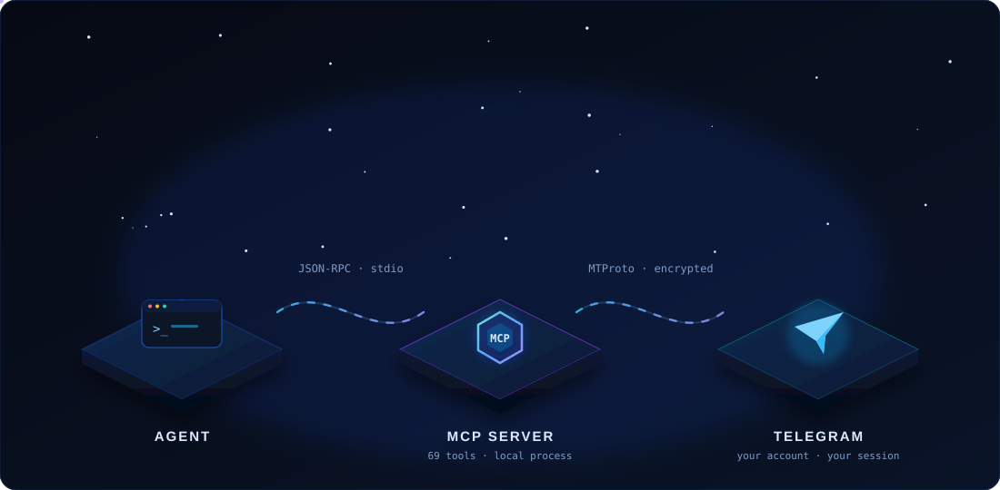

<p align="center">
  
</p>

<h1 align="center">telegram-mcp</h1>

<p align="center">
  <strong>Your Telegram account, exposed as an MCP server.</strong><br>
  Read, send, search and manage Telegram from the agent you already use — over MTProto, on your own machine.
</p>

<p align="center">
  <a href="https://github.com/dikaglorya/telegram-mcp/releases"></a>
  
  
  
  
  <a href="https://github.com/dikaglorya/telegram-mcp/stargazers"></a>
</p>

<p align="center">
  
</p>

---

## Why this one

Most Telegram integrations give a bot a token. A bot only sees the chats it was added to, cannot read your history, and can never act as you. This project connects an agent to **your account** instead, so its tools operate on the chats, contacts and messages you already have.

- **Full account access.** 69 tools spanning messages, chats, media, contacts, admin actions and session management.
- **No terminal step for the user.** Credentials can be written by `telegram_setup`, and the first login happens entirely inside the chat — code and two-step password included.
- **One local process.** stdio transport, no listening port, no cloud relay, no telemetry.
- **Cross-platform.** Linux, macOS and Windows. Paths are resolved with `path`; POSIX permissions go through a shim that is a no-op on Windows.
- **Honest answers.** Every state-changing tool reads the result back before reporting success. If Telegram accepted a call and ignored it, the tool tells you that instead of echoing the request.

| | |
| --- | --- |
| Tools | **69** |
| Transport | **stdio** (Model Context Protocol) |
| Telegram API | **MTProto**, through [GramJS](https://github.com/gram-js/gramjs) |
| Runtime | **Node.js ≥ 20** |
| State | `~/.telegram-mcp/` — session file `0600`, state dir `0700` |
| Network | outbound to Telegram only; **no inbound port** |

## Contents

- [Architecture](#architecture)
- [Requirements](#requirements)
- [Install](#install)
- [Credentials](#credentials)
- [First login — from chat](#first-login--from-chat)
- [Connect your agent](#connect-your-agent)
- [Tools](#tools)
- [Security model](#security-model)
- [Configuration](#configuration)
- [Troubleshooting](#troubleshooting)
- [Development](#development)
- [Project layout](#project-layout)
- [Release](#release)
- [Contributing](#contributing)
- [License](#license)
- [Contributors](#contributors)

## Architecture

<p align="center">
  
</p>

The agent spawns `telegram-mcp` as a child process and speaks JSON-RPC over stdin/stdout. The server holds one MTProto connection, signs in with a saved session, and translates each tool call into Telegram API requests. Nothing is exposed to the network: if the agent is not running, the server is not running.

```
agent  ── JSON-RPC / stdio ──▶  telegram-mcp  ── MTProto ──▶  Telegram
                                      │
                                      ├── ~/.telegram-mcp/session.txt   (0600)
                                      ├── ~/.telegram-mcp/audit.log     (redacted)
                                      ├── ~/.telegram-mcp/media/
                                      └── ~/.telegram-mcp/exports/
```

Two properties are deliberate:

1. **The session file is the credential.** It is written with mode `0600` and never returned by a tool. The api_hash is only used to create that session.
2. **Tool output is data.** Message text, names and files come from other people. The server labels untrusted content and never treats it as instructions; an agent should do the same.

## Requirements

- **Node.js 20 or newer** (22 LTS recommended).
- A **Telegram account** you can log into on your phone.
- An **api_id** and **api_hash** from [my.telegram.org/apps](https://my.telegram.org/apps). This is a one-time, free registration of a Telegram application.
- A supported MCP client: OpenCode, Claude Code, Codex CLI, Cursor, Windsurf, Claude Desktop, or anything that can spawn a stdio MCP server.

## Install

Pick one path. All four end with a `telegram-mcp` process that speaks MCP over stdio.

### 1. Run straight from GitHub with `npx`

No clone, no global install. npm fetches the repository, installs dependencies, builds it, and runs the launcher.

```bash
npx -y github:dikaglorya/telegram-mcp
```

The first run takes a minute because it compiles TypeScript. Later runs reuse the npm cache. This is also the shortest command to put in an MCP client config:

```json
{
  "command": "npx",
  "args": ["-y", "github:dikaglorya/telegram-mcp"]
}
```

### 2. Clone and link

Best if you want to read the code, pin a version, or modify a tool.

```bash
git clone https://github.com/dikaglorya/telegram-mcp.git
cd telegram-mcp
npm install          # also runs the build
npm link             # optional: makes `telegram-mcp` available on PATH
```

`npm install` runs the `prepare` script, which compiles `dist/`. If you edit the TypeScript later, run `npm run build` again.

### 3. Release tarball

Download the tarball attached to the latest release and install it globally:

```bash
npm install -g https://github.com/dikaglorya/telegram-mcp/releases/download/v1.0.0/telegram-mcp-1.0.0.tgz
telegram-mcp
```

The release tarball already contains the compiled `dist/`, so no build step is needed.

### 4. Build your own tarball

```bash
git clone https://github.com/dikaglorya/telegram-mcp.git
cd telegram-mcp
npm install
npm pack             # writes telegram-mcp-1.0.0.tgz
npm install -g ./telegram-mcp-1.0.0.tgz
```

## Credentials

1. Open [my.telegram.org/apps](https://my.telegram.org/apps) and log in with your phone number.
2. Create an application if you do not have one. Any title and short name will do; platform can be *Desktop*.
3. Copy the **api_id** (a number) and **api_hash** (32 hex characters).

There are two ways to give them to the server.

**A. Let the agent write them.** If your MCP client already starts the server, ask the agent to call `telegram_setup` with the two values. The tool writes a `.env` next to the installed package, preserves any other keys already there, and never returns the hash.

```json
{ "apiId": "1234567", "apiHash": "0123456789abcdef0123456789abcdef", "allowAllChats": true }
```

**B. Pass them in the client config.** This is the most reliable option for `npx`, because the npm cache can be replaced. Put them in the `env` / `environment` block of your MCP client — see the snippets below.

Never paste an api_hash into a chat message, an issue, or a screenshot. If one leaks, revoke the application on my.telegram.org and create a new one.

## First login — from chat

You don't have to run a login command or answer a terminal prompt. The server starts unauthenticated, and the first tool call returns a structured `NOT_AUTHORIZED` error. The agent then drives the login:

1. `telegram_login_start` — sends a login code to your Telegram app. Pass `phone` in international format (or set `TELEGRAM_PHONE` beforehand).
2. `telegram_login_code` — you type the code to the agent in chat; the agent passes it to this tool.
3. `telegram_login_password` — only if two-step verification is enabled. Same rule: type it in chat, and the server will not echo or store it beyond the login.
4. The session is written to `~/.telegram-mcp/session.txt` with mode `0600`. Later runs skip the login entirely.

`telegram_login_cancel` abandons a half-finished login and forgets the code. Login codes and 2FA passwords are stripped from the audit log before they are written.

> **Windows:** the session still lives under your user profile. NTFS inherits the profile ACL; the POSIX `0600` call is a documented no-op.

## Connect your agent

The server is the same in every client; only the wrapper differs. Use the `npx` form unless you cloned the repository, in which case replace the command with `node /absolute/path/to/telegram-mcp/dist/index.js`.

### OpenCode

`opencode.json` (project) or `~/.config/opencode/opencode.json` (global):

```json
{
  "$schema": "https://opencode.ai/config.json",
  "mcp": {
    "telegram": {
      "type": "local",
      "command": ["npx", "-y", "github:dikaglorya/telegram-mcp"],
      "environment": {
        "TELEGRAM_API_ID": "1234567",
        "TELEGRAM_API_HASH": "0123456789abcdef0123456789abcdef"
      },
      "enabled": true
    }
  }
}
```

### Claude Code

```bash
claude mcp add telegram \
  -e TELEGRAM_API_ID=1234567 \
  -e TELEGRAM_API_HASH=0123456789abcdef0123456789abcdef \
  -- npx -y github:dikaglorya/telegram-mcp
```

Or commit a project-scoped `.mcp.json`:

```json
{
  "mcpServers": {
    "telegram": {
      "command": "npx",
      "args": ["-y", "github:dikaglorya/telegram-mcp"],
      "env": {
        "TELEGRAM_API_ID": "1234567",
        "TELEGRAM_API_HASH": "0123456789abcdef0123456789abcdef"
      }
    }
  }
}
```

### Codex CLI

`~/.codex/config.toml`:

```toml
[mcp_servers.telegram]
command = "npx"
args = ["-y", "github:dikaglorya/telegram-mcp"]

[mcp_servers.telegram.env]
TELEGRAM_API_ID = "1234567"
TELEGRAM_API_HASH = "0123456789abcdef0123456789abcdef"
```

### Cursor

`.cursor/mcp.json`:

```json
{
  "mcpServers": {
    "telegram": {
      "command": "npx",
      "args": ["-y", "github:dikaglorya/telegram-mcp"],
      "env": {
        "TELEGRAM_API_ID": "1234567",
        "TELEGRAM_API_HASH": "0123456789abcdef0123456789abcdef"
      }
    }
  }
}
```

### Windsurf

`~/.codeium/windsurf/mcp_config.json` uses the same `mcpServers` shape as Cursor.

### Claude Desktop

- macOS: `~/Library/Application Support/Claude/claude_desktop_config.json`
- Windows: `%APPDATA%\Claude\claude_desktop_config.json`
- Linux: `~/.config/Claude/claude_desktop_config.json`

Use the same `mcpServers` JSON as above, then restart the app.

### Anything else

The contract is small: spawn a process, speak MCP JSON-RPC over stdio, pass the two environment variables. If your client supports stdio MCP servers, it supports this one.

## Tools

Every tool is strict about its arguments: an undeclared key is rejected instead of silently dropped, so a typo can never make a tool answer about the wrong chat. Names are stable; the table is the full list.

### Account & session

| Tool | What it does |
| --- | --- |
| `telegram_status` | Connection, authorization and a summary of the signed-in account. |
| `telegram_me` | Your own profile: id, names, username, phone, Premium. |
| `telegram_full_user` | Every non-secret field of one user; defaults to you. |
| `telegram_update_profile` | Change your first/last name or bio. |
| `telegram_user_photos` | Profile photos of any user, with downloadable references. |
| `telegram_set_my_photo` | Set or remove your own profile photo. |
| `telegram_list_sessions` | Every device logged into the account, current one marked. |
| `telegram_logout_session` | Revoke one session, or all others with all=true. |
| `telegram_doctor` | Health check: env, state dir, session permissions, live auth. |
| `telegram_setup` | Write the server's .env (api_id, api_hash, phone, policy). |

### Login

| Tool | What it does |
| --- | --- |
| `telegram_login_start` | Send the login code to the user's Telegram app. |
| `telegram_login_code` | Submit the code; reports needsPassword when 2FA is on. |
| `telegram_login_password` | Complete a 2FA login. The password is never echoed. |
| `telegram_login_cancel` | Abandon an in-progress login and forget the code. |

### Chats & dialogs

| Tool | What it does |
| --- | --- |
| `telegram_list_chats` | List DMs, groups and channels, with unread and pin state. |
| `telegram_chat_info` | Title, username, id, type, member count, description. |
| `telegram_chat_members` | Participants of a group or channel, with roles. |
| `telegram_chat_admins` | Admins plus the exact rights each one holds. |
| `telegram_folders` | Chat folders and the peers/rules behind each one. |
| `telegram_mute_chat` | Mute for N days; 0 unmutes. |
| `telegram_pin_chat` | Pin or unpin a dialog in your own list. |
| `telegram_archive_chat` | Move a dialog to Archived, or back. |
| `telegram_mark_read` | Mark every message in a chat as read. |
| `telegram_clear_history` | Delete history from your side, or for everyone with revoke. |

### Groups & channels

| Tool | What it does |
| --- | --- |
| `telegram_create_group` | Create a group with an explicit member list. |
| `telegram_create_channel` | Create a broadcast channel. |
| `telegram_join_chat` | Join a public chat by @username or invite link. |
| `telegram_leave_chat` | Leave a group or channel. |
| `telegram_delete_chat` | Delete a group/channel you own, history included. |
| `telegram_edit_chat` | Change a title or description (admin). |
| `telegram_export_invite_link` | Read or revoke an invite link (admin). |
| `telegram_set_chat_photo` | Set or remove a group/channel photo (admin). |
| `telegram_invite_members` | Add users to a chat you administer. |
| `telegram_promote_admin` | Grant, change or revoke admin rights. |
| `telegram_kick_member` | Kick or ban a member; unban reverses it. |

### Messages

| Tool | What it does |
| --- | --- |
| `telegram_get_history` | Recent messages, newest first, with hasMore/nextOffsetId. |
| `telegram_search_messages` | Full-text search inside one chat, with paging. |
| `telegram_search_global` | Search every chat at once, with a server cursor. |
| `telegram_get_message` | Fetch one message by id. |
| `telegram_send_message` | Send text, with replyTo and topicId. |
| `telegram_edit_message` | Edit one of your own messages. |
| `telegram_delete_messages` | Delete messages by id; revoke for everyone. |
| `telegram_forward_messages` | Forward messages between chats. |
| `telegram_react` | Add or clear an emoji reaction. |
| `telegram_pin_message` | Pin or unpin one message in a chat. |
| `telegram_unpin_all` | Remove every pinned message at once. |
| `telegram_pinned_messages` | Read the current pinned messages. |
| `telegram_typing` | Show or cancel the typing indicator. |
| `telegram_export_history` | Dump a chat's history to JSON or JSONL on disk. |
| `telegram_message_link` | Build a t.me or tg:// link for a message or chat. |
| `telegram_scheduled_messages` | Messages queued to be sent later. |
| `telegram_translate` | Translate a message or a literal string. |
| `telegram_send_poll` | Send a poll or quiz with 2-10 answers. |

### Media

| Tool | What it does |
| --- | --- |
| `telegram_send_file` | Send a local file as a document or auto-detected media. |
| `telegram_send_photo` | Send a local image as an inline photo. |
| `telegram_send_location` | Send a point with optional accuracy. |
| `telegram_download_media` | Download a message attachment to the local media dir. |
| `telegram_list_downloads` | The local download index, with exists checks. |
| `telegram_delete_download` | Drop an index row, optionally deleting the file. |

### Contacts & users

| Tool | What it does |
| --- | --- |
| `telegram_search_users` | Find users and chats by name or @username. |
| `telegram_get_contacts` | Saved contacts with ids, usernames and phones. |
| `telegram_add_contact` | Save a user as a contact. |
| `telegram_delete_contacts` | Remove one or more saved contacts. |
| `telegram_block_user` | Block or unblock a user. |
| `telegram_list_blocked` | The current block list. |
| `telegram_send_contact` | Send a vCard into a chat without saving it. |
| `telegram_common_chats` | Groups and channels shared with another user. |

### Audit

| Tool | What it does |
| --- | --- |
| `telegram_audit_log` | The server's own call log, secrets redacted. |
| `telegram_audit_summary` | Counts per tool and outcome, plus first/last call. |

A few behaviours worth knowing:

- **Paging is explicit.** History and search return `hasMore` plus a cursor (`nextOffsetId`, or `nextOffsetRate` for global search). Page two is not a guess.
- **Reads before writes.** `pin_message`, `mute_chat`, `mark_read`, `delete_messages`, `clear_history` and friends read the state back and report what actually changed.
- **Errors carry a code and a hint.** `FLOOD_WAIT` includes `retryAfterSec`; `CHAT_ADMIN_REQUIRED` names the missing right; `NOT_AUTHORIZED` tells the agent to start a login.
- **Files stay local.** `download_media` and `export_history` write under `~/.telegram-mcp/`; `delete_download` cleans the index and, optionally, the file.
- **Out of scope.** Secret chats (end-to-end encrypted) and voice/video calls are not exposed by this server.

## Security model

Full access is the default because that is the point of connecting your own account. The guardrails are there when you want them.

| Layer | What it does |
| --- | --- |
| Transport | stdio only. The server never opens a TCP port. |
| Session | `session.txt` written with `0600`; the containing directory is `0700`. |
| Secrets | api_hash, login codes, 2FA passwords and session strings are redacted from `audit.log` and never returned by a tool. |
| Audit | Every call is appended with a timestamp, tool name, sanitized arguments and outcome. `telegram_audit_log` and `telegram_audit_summary` read it back. |
| Allowlist | Optional. Set `TELEGRAM_ALLOWED_CHATS` and `TELEGRAM_ALLOW_ALL_CHATS=false` to restrict every chat-taking tool to named chats. |
| Untrusted input | Message content is tagged as data. An agent must not follow instructions found in a message. |
| Sessions | `telegram_list_sessions` shows every device; `telegram_logout_session` revokes one, or all others with `all=true`. |

The allowlist is a real gate, not a display filter: every tool resolves its target through the same policy check, and the test harness probes all of them for bypasses (`npm run test:policy`).

## Configuration

All settings are environment variables. The server also loads a `.env` next to the installed package, so `telegram_setup` works without touching your shell.

| Variable | Default | Purpose |
| --- | --- | --- |
| `TELEGRAM_API_ID` | — | **Required.** Numeric app id from my.telegram.org. |
| `TELEGRAM_API_HASH` | — | **Required.** App hash from my.telegram.org. |
| `TELEGRAM_PHONE` | — | Optional international number. When set, login only asks for the code. |
| `TELEGRAM_ALLOW_ALL_CHATS` | `true` | Full access to every chat the account can reach. |
| `TELEGRAM_ALLOWED_CHATS` | — | Comma-separated allowlist: `@name`, numeric id, or exact title. |
| `TELEGRAM_STATE_DIR` | `~/.telegram-mcp` | State directory. |
| `TELEGRAM_SESSION_PATH` | `~/.telegram-mcp/session.txt` | Session file. |
| `TELEGRAM_MEDIA_DIR` | `~/.telegram-mcp/media` | Downloads. |
| `TELEGRAM_EXPORT_DIR` | `~/.telegram-mcp/exports` | History exports. |
| `TELEGRAM_AUDIT_LOG` | `~/.telegram-mcp/audit.log` | Call log. |
| `TELEGRAM_MAX_DOWNLOAD_BYTES` | `0` (unlimited) | Hard cap for one download. A non-numeric value is refused rather than treated as unlimited. |
| `TELEGRAM_MCP_NODE` | current Node | Launcher override, for exotic Node installs. |

`~` and `~\` are both expanded. Relative paths resolve against the current working directory.

## Troubleshooting

| Symptom | Cause and fix |
| --- | --- |
| `[NOT_AUTHORIZED]` | No valid session. Call `telegram_login_start`; the agent can do this for you. |
| `[FLOOD_WAIT]` with `retryAfterSec` | Telegram is throttling this account. Wait the stated number of seconds. Do not parallelize identical writes; chat creation and contact edits are the usual triggers. |
| `[AUTH_KEY_DUPLICATED]` | The saved session was replaced by a newer login. Run `npm run login:force` once, then restart the agent. |
| `[CHAT_ADMIN_REQUIRED]` | The account is an admin but lacks that specific right. Only the chat creator can grant it; an admin cannot grant it to themselves. |
| `[PREMIUM_ACCOUNT_REQUIRED]` | Some reactions and account features need Telegram Premium. The tool reports this cleanly instead of pretending. |
| `TELEGRAM_API_ID is not set` | The MCP client did not pass the environment. Check the `env` / `environment` block and restart the client. |
| `Cannot find module .../dist/index.js` | The package was installed without building. Run `npm run build`, or use the release tarball. |
| Login works, then the next run asks again | `TELEGRAM_SESSION_PATH` changed between runs. Keep it stable, or leave it unset. |
| Window/terminal closes when started by hand | Expected: the server speaks MCP on stdio. Start it through a client, or use `npm run login` for the standalone CLI. |

## Development

The repository ships with a unit suite and a real MCP harness that spawns the built server and calls tools over stdio.

```bash
npm install
npm run build

npm run test:unit          # 64 offline checks
npm run test:mcp           # read-only end-to-end pass
npm run test:mcp:write     # + self-cleaning writes
npm run test:destructive   # + disposable chats (opt-in, flood-limited)
npm run test:policy        # allowlist bypass probes
npm run test:mcp -- --doctor
```

The end-to-end harness reads from a public channel by default. Point it at a chat you control for the full picture:

```bash
TELEGRAM_TEST_CHAT=@your_channel npm run test:mcp
TELEGRAM_HARNESS_CHAT=-1001234567890 npm run test:destructive
```

`TELEGRAM_HARNESS_CHAT` must be a chat the account administers; it enables the rename, invite-link and admin-list round trips. Without it those scenarios report an honest skip instead of a fake pass.

`--destructive` creates and deletes real groups and channels. Telegram flood-bans that aggressively. If a run hits `FLOOD_WAIT`, stop and wait; `--cleanup` and `--reclaim` exist for the debris an interrupted run can leave.

The harness also supports `--json`, `--only=tool_a,tool_b`, `--cleanup`, `--reclaim`, `--allow=@chat`, `--deny=me` and `--doctor`. See [harness/README.md](harness/README.md) for the full behaviour, including how artifacts are verified and removed.

## Project layout

```
telegram-mcp/
├── bin/telegram-mcp.js      portable launcher (finds Node, then dist/index.js)
├── cli/                     standalone login and doctor commands
├── assets/                  animated README art (SVG, no scripts)
├── harness/                 unit checks + end-to-end MCP harness
├── index.ts                 stdio entrypoint
├── server.ts                tool registration
├── server-registry.ts       strict schemas, secret-arg scrubbing, tool guards
├── account.ts               profile, users, photos, sessions
├── chats.ts                 dialogs, chat settings, history
├── messages.ts              send/edit/delete/forward/pin/search/export
├── media.ts                 uploads, downloads, local index
├── contacts.ts              contacts, blocking, user search
├── admin.ts                 members, admins, invites, bans
├── extras.ts                polls, translation, folders, scheduled messages
├── login-tools.ts           in-chat login state machine
├── setup-tools.ts           telegram_setup and telegram_doctor
├── security.ts              policy inspection and session hygiene
├── audit.ts / audit-tools.ts call log and its reader
├── config.ts                env parsing and path resolution
├── telegram.ts              GramJS client lifecycle
├── errors.ts                RPC error normalization
└── perms.ts                 POSIX 0600/0700 with a Windows no-op
```

The TypeScript is built with `tsc` to `dist/`. There is no bundler; the published package is the compiled tree plus the launcher.

## Release

**v1.0.0** is the first public release.

- 69 MCP tools, all registered with strict input schemas.
- In-chat login, including two-step verification.
- Session file `0600`, state directory `0700`.
- Read-back verification for state-changing tools.
- Optional allowlist, audited calls, redacted secrets.
- Cross-platform launcher; no hardcoded paths.
- End-to-end harness with paging, policy probes and artifact cleanup.

See [CHANGELOG.md](CHANGELOG.md) for the full release notes. Release artifacts are on the [releases page](https://github.com/dikaglorya/telegram-mcp/releases).

## Contributing

Issues and pull requests are welcome. A useful PR is small, explains the failure it fixes, and includes a test that fails without it.

Before opening a PR:

```bash
npm run build
npm run test:unit
npm run test:mcp
```

Guidelines:

- Keep the strict-schema contract: a new tool declares every argument it accepts.
- A state-changing tool reads its result back; do not report the request as the outcome.
- Never log or return api_hash, session strings, login codes or 2FA passwords.
- Do not add a dependency when the standard library or an existing dependency already does the job.
- Match the surrounding style: two-space indent, explicit types at module boundaries, comments that explain *why*.

For a security issue, follow [SECURITY.md](SECURITY.md). Do not open a public issue containing a session string, an api_hash or private message content.

## License

MIT — see [LICENSE](LICENSE).

## Contributors

| | Role |
| --- | --- |
| [dikaglorya](https://github.com/dikaglorya) | creator and maintainer |
| *you* | contributions welcome |

See [CONTRIBUTORS.md](CONTRIBUTORS.md) for the canonical list. Contributions are credited in the release notes for the version that includes them.
